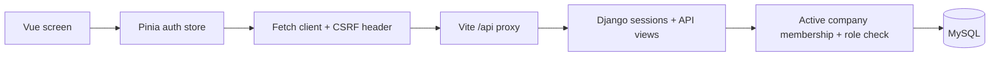

# Developer guide

## How a request works



The browser uses one origin, normally `localhost:5173`. Vite forwards `/api` to
`backend:8000` within Docker. Django keeps the session in the database and sends
an HttpOnly session cookie. The CSRF cookie is readable by Vue so it can attach
`X-CSRFToken` to writes. No token is stored in localStorage. Use the same hostname
consistently; `localhost` and `127.0.0.1` have separate cookies.

The active company ID is a session preference. It is never accepted as proof of
permission. Each company endpoint checks the signed-in user's current membership.

## Where to change code

| File or folder | Responsibility |
| --- | --- |
| `backend/config/urls.py` | Main URL routing |
| `backend/config/settings/` | Database, sessions, CSRF, and local settings |
| `backend/apps/accounts/models.py` | Email-based user model |
| `backend/apps/accounts/views.py` | Session, login, and logout APIs |
| `backend/apps/companies/models.py` | Company and company membership |
| `backend/apps/companies/access.py` | Shared company access checks and serialization |
| `backend/apps/companies/views.py` | Company creation/selection and team permissions |
| `backend/apps/core/api.py` | JSON parsing, validation, API errors, and authentication wrapper |
| `backend/apps/business/models.py` | Business records, documents, stock ledger, payments, projects, activity |
| `backend/apps/business/catalog.py` | Explicit catalog fields and company-scoped validation |
| `backend/apps/business/services.py` | Decimal totals, numbering, stock fulfillment, and payment rules |
| `backend/apps/business/views.py` | Catalog/document actions, dashboard, preferences, and pagination |
| `backend/apps/business/management/commands/seed_demo.py` | Isolated demo data for an existing account |
| `frontend/src/services/api.js` | Requests, timeouts, CSRF, and API errors |
| `frontend/src/stores/auth.js` | Current user, accessible companies, selected company |
| `frontend/src/router/index.js` | Routes and sign-in requirements |
| `frontend/src/views/` | Login, overview, companies, team, and guide screens |
| `frontend/src/assets/main.css` | Shared styles and responsive layouts |
| `frontend/src/assets/erp.css` | Odoo-style application shell and business screens |
| `frontend/src/data/modules.js` | App launcher registry and catalog form definitions |
| `frontend/src/composables/erp.js` | Company-scoped loading, stale-response handling, and formatting |

## Make and verify a change

1. Start Docker using [the setup guide](../SETUP.md).
2. Edit Python or Vue source. The development containers reload mounted source.
3. For model changes, create and commit migrations:

   ```powershell
   docker compose exec backend python manage.py makemigrations
   docker compose exec backend python manage.py migrate
   ```

4. Run the project checks from the root:

   ```powershell
   powershell -ExecutionPolicy Bypass -File scripts/check.ps1
   ```

   Or run the individual commands in SETUP.md. A dependency change also needs a
   container rebuild. Frontend dependency changes must include package-lock.json.

5. Walk through the user guide and inspect the mobile layout before sharing changes.

The login/company module reuses existing models. Business apps add the committed
`business/0001_initial` migration; startup applies it automatically.
Tests create a separate MySQL test database; they do not change the application DB.

## Permission rules and transactions

Use `membership_for(request.user, company_id)` before reading company data. It
requires both an active membership and an active company and returns 404 for
inaccessible IDs. Do not grant automatic application access based on `is_staff`
or `is_superuser`. Route guards and hidden buttons improve the interface; Django
is responsible for enforcing access.

Team writes lock the Company row inside a database transaction, then re-read the
actor's permission. This serializes changes within that company and protects the
last active owner when ownership changes happen concurrently. All future team
write paths must follow the same locking order. Django Admin is a trusted global
maintenance tool and does not use these application API rules.

## Add the next module

1. Agree its fields and workflow before implementation. See
   [ODOO-COVERAGE.md](ODOO-COVERAGE.md) for module gaps and [ROADMAP.md](ROADMAP.md)
   for the development sequence.
2. Add a Django app. Give each business record a Company foreign key.
3. Scope every query and related-record lookup to the authorized company.
4. Add validation and explicit read/write permission rules.
5. Add migrations, API endpoints, and tests for cross-company access and failures.
6. Add a Vue route and screen using the existing API client and auth store.
7. Watch the active company ID, clear old data on switching, and discard stale
   responses. `TeamView.vue` demonstrates this pattern.
8. Update the API and user guides and run the checks.

The current module is a local development feature. A production release still
needs deployment settings, HTTPS and secure cookies, a production server, login
trusted-ingress/rate-limit tuning, externally verified recovery delivery, operational logging, and backups.

The [foundation phase](FOUNDATION.md) adds the shared MySQL throttle and queued
password recovery, plus audit regressions. `accounts/recovery.py` processes mail
outside HTTP requests; `accounts/security.py` owns throttling. The dedicated mailer
service runs `process_auth_mail --loop`. Self-service account screens are in
`AccountView.vue`, `ForgotPasswordView.vue`, and `ResetPasswordView.vue`.
`.github/workflows/check.yml` runs container-based checks after source is pushed.

All business writes lock the Company row inside a transaction. This serializes
number allocation, stock checks, order fulfillment, and payment balance checks.
It favors correctness for a small workspace; high-volume operation may later need
finer-grained locks while preserving these invariants. Confirmed orders are immutable;
invoices reuse their frozen lines. Business models are read-only in Django Admin
to prevent bypassing workflow rules. Company deletion is restricted by protected
business references. Catalog APIs use archiving.

Run `node scripts/verify-browser.mjs` to exercise login plus the full core ERP
workflow on Windows/Edge. It delegates business steps to `scripts/browser-erp-flow.mjs`
and cleans up only its temporary company records in dependency order.

The [Vue component guide](VUE-COMPONENTS.md) documents the shared presentation
components and catalog patterns. [CONTACTS-PRODUCTS.md](CONTACTS-PRODUCTS.md) is
the user walkthrough. Catalog transfers live in `business/catalog_transfer.py`;
`business/test_catalog.py` covers scoped filters, bulk changes, CSV validation,
preview binding, atomicity and safe retries. `scripts/browser-catalog-flow.mjs`
adds real catalog workflows to the full smoke suite. For a focused browser pass,
run `node scripts/verify-browser.mjs --catalog-only`; it writes a separate
`.local/catalog-browser-results.json` and does not replace the full suite record.
