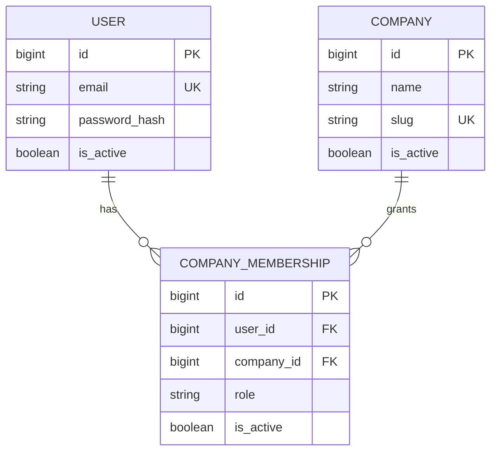

# Database and access model

`accounts.User` uses Django authentication fields with a unique email instead of
a username. Passwords use Django's configured password hashing.

`companies.Company` has a display name, unique slug, active flag, and timestamps.
The application generates a slug when creating a company.

`companies.CompanyMembership` links a user to one company with a role (`owner`,
`admin`, or `member`), active flag, and creation timestamp. A database constraint
ensures each company/user pair is unique. Deleting a user or company cascades its
memberships. The application uses reversible membership deactivation.

One user may belong to multiple companies with different roles. The API requires
both an active company and active membership. The application prevents removal of
the last active owner by locking the Company row for team writes. Trusted Django
Admin users can edit records directly and must preserve ownership themselves.

Django's session table stores the authenticated session and selected company ID.
That selected ID is a preference; APIs independently check membership. No schema
changes were needed for the login/company module.

The development database is `MYSQL_DATABASE`. Tests use the separate
`test_<MYSQL_DATABASE>` database. Its privileges are scoped to that exact name by
the first-run MySQL init script.

## Business tables

The `business` app adds:

| Table/model | Purpose |
| --- | --- |
| WorkspaceSettings | One company currency, locked after the first order |
| Contact | Customer/supplier identities and contact details |
| Product | Company-unique SKU and optional barcode, category, goods/service type, prices, cost, unit, stock threshold |
| ProductCategory | Company-unique name, archive flag; protected category references on products |
| CatalogImport | Confirmed import token digest, resource/count, timestamps; safe retry receipt without CSV contents |
| Opportunity | Contact-linked CRM pipeline record |
| DocumentSequence | Company/prefix counter used while the Company row is locked |
| Order / OrderLine | Sale/purchase documents, snapshots, decimal totals, immutable confirmed lines |
| StockMovement | Signed, append-only inventory changes linked to product and optional order |
| Invoice | One invoice/bill per order, frozen party/currency/totals, status and due date |
| Payment | Manual amount/date/method/reference with a unique retry UUID |
| Project / Task | Company projects and staged tasks, optional active-member assignment |
| Activity | Actor email and business-event summaries |

All top-level business records have a Company foreign key. API validation also
scopes every related-record lookup. A foreign-key ID alone never authorizes a link.
Business references use PROTECT, and there are no business DELETE endpoints.
Company deletion with existing documents is restricted. Catalog records are archived.

Quantities have three decimals; prices/totals have two. Stock is calculated from
movement sums, paid amounts from payment sums, and document totals from Decimal
line calculations. Company row locking serializes business writes and prevents
duplicate fulfillment, overselling, overpayment, and conflicting sequence allocation.
Confirmed order lines supply invoice lines and cannot be changed through the API.

The catalog follow-up migration is additive: existing products start without a
category/barcode. Barcode uses nullable storage so a company may have many empty
values while non-empty `(company, barcode)` pairs remain unique. Category names
are company-unique under MySQL's configured collation. APIs validate category
company/active status; archived historical references can be retained.

CSV preview performs validation without writes. Commit revalidates and saves all
rows, activity and a unique token-digest receipt in one company-locked transaction.
Sequential/concurrent retries find the receipt instead of creating another batch.
